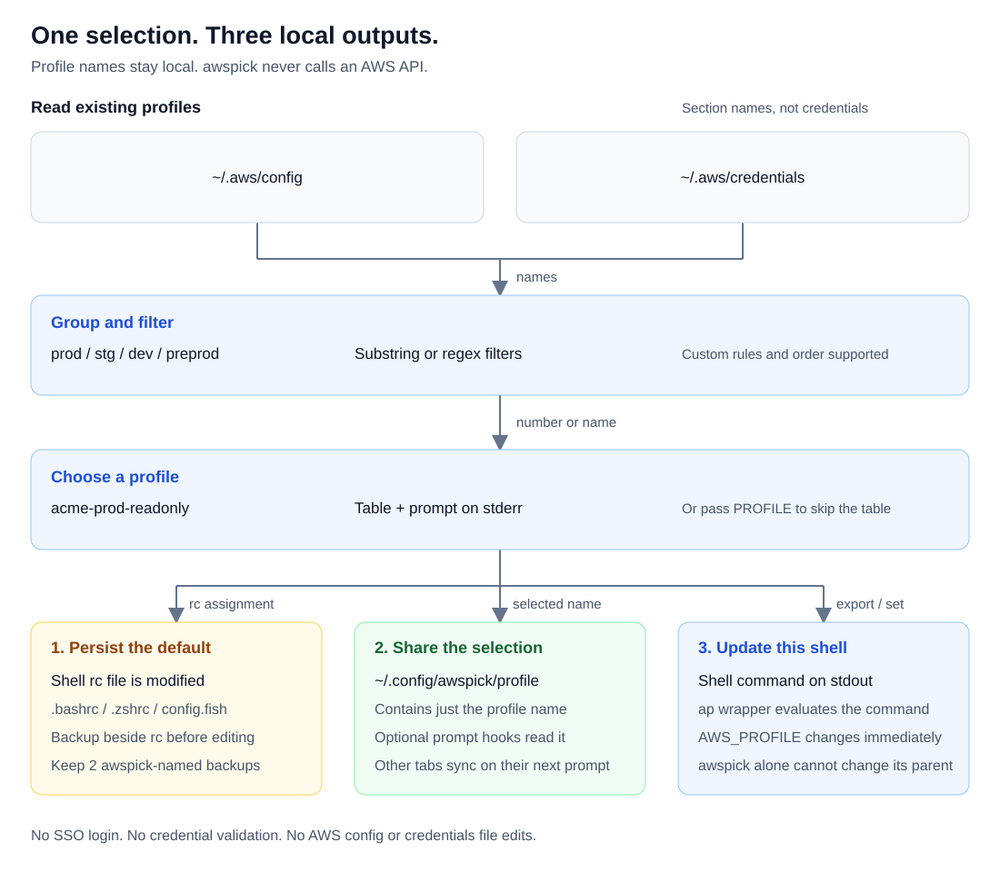

# awspick

Pick an AWS profile from a grouped, filterable list and apply it to your shell.

[](https://crates.io/crates/awspick)
[](https://github.com/KKamJi98/aws-profile-pick/actions/workflows/release-please.yml)
[](https://github.com/KKamJi98/aws-profile-pick/blob/main/LICENSE)


[Watch the MP4](https://github.com/KKamJi98/aws-profile-pick/blob/main/docs/demo/awspick.mp4) | [Reproduce the demo](https://github.com/KKamJi98/aws-profile-pick/blob/main/docs/demo/README.md)

**Before you run it:** selecting a profile edits your shell rc file and saves a backup. The `ap` wrapper below also applies it to the current shell. No AWS API calls, SSO login, or credential validation.

## Why awspick?

| Without a picker | With awspick |
| --- | --- |
| Find a name in a long list, then type `export AWS_PROFILE=...`. | See environment groups, the current profile, and numbered choices together. |
| Remember the exact account/role profile name. | Narrow the list with substrings or regex, then choose a number or name. |
| Change the current tab but forget the next shell. | Persist the default in your rc file; optionally sync other tabs at their next prompt. |

Already know the name? `ap acme-dev-admin` skips the menu. This is a small profile picker, not an AWS login or credential manager.

## Installation

### Homebrew (macOS, Linux)

```bash
brew install KKamJi98/tap/awspick
```

### Cargo

```bash
cargo install --locked awspick
```

### GitHub Release

Download an archive from [GitHub Releases](https://github.com/KKamJi98/aws-profile-pick/releases/latest), verify it against `SHA256SUMS`, and put `awspick` on your `PATH`.

| Platform | Archive target |
| --- | --- |
| macOS, Apple Silicon | `aarch64-apple-darwin` |
| macOS, Intel | `x86_64-apple-darwin` |
| Linux, x86-64 | `x86_64-unknown-linux-musl` |
| Linux, ARM64 | `aarch64-unknown-linux-musl` |

Archives are named `awspick-<version>-<target>.tar.gz`. Linux binaries use musl. Windows and PowerShell are not supported. You can also verify the build provenance:

```bash
gh attestation verify awspick-<version>-<target>.tar.gz --repo KKamJi98/aws-profile-pick
```

<details>
<summary>Moving from the Python / PyPI version (2.x)</summary>

The PyPI package is `aws-profile-pick`; the Rust crate and executable are `awspick`. Python is no longer required. PyPI stops at 2.0.2 and receives no new releases.

Install the binary first. If you installed the old version with `uv tool`, remove that installation and check which command is on your `PATH`:

```bash
brew install KKamJi98/tap/awspick  # or: cargo install --locked awspick
uv tool uninstall aws-profile-pick
command -v awspick
awspick --version
```

Existing `eval "$(awspick)"` wrappers still work. `INFO:` logs now require `-v`. New options include direct profile selection, `--version`, and `--completions`. See the [migration record](https://github.com/KKamJi98/aws-profile-pick/blob/main/docs/rust-migration.md) for compatibility details and fixes. To return to the old uv installation, remove the Rust installation with its package manager and run `uv tool install aws-profile-pick==2.0.2`.

</details>

## Quick start

Use profiles you have already configured. The names below are synthetic fixtures from the demo, not profiles awspick creates for you.

For **bash or zsh**, define this helper in your current session. It preserves cancellation and failure status:

```bash
ap() {
  local output
  output=$(command awspick "$@") || return $?
  eval "$output"
}
```

For fish, use the [fish wrapper](#fish) below. A plain `awspick` invocation still edits the rc file, but cannot change its parent shell's environment. The wrapper evaluates only the shell command on stdout; menus and status messages stay on stderr.

### 1. Pick from an environment group

```bash
ap --groups dev  # enter 1 at the prompt
printf 'AWS_PROFILE=%s\n' "$AWS_PROFILE"
```

stdout after the check:

```text
AWS_PROFILE=acme-dev-admin
```

Run `ap` without flags to see every group. Select by displayed number or profile name. Press Enter, enter `q` / `quit` / `exit`, or press Ctrl-C to cancel without selecting a profile.

### 2. Switch directly by name

```bash
ap acme-stage-readonly
printf 'AWS_PROFILE=%s\n' "$AWS_PROFILE"
```

```text
AWS_PROFILE=acme-stage-readonly
```

The positional name skips the table and prompt. It uses an exact match first, then a unique case-insensitive match. **Filters and group restrictions do not apply to direct selection.**

### 3. Filter with a regex, then select

```bash
ap --regex -f '^acme-prod-.*readonly$'  # enter 1 at the prompt
printf 'AWS_PROFILE=%s\n' "$AWS_PROFILE"
```

The real menu on stderr (excerpt, before the prompt):

```text
┏━━━━━┳━━━━━━━━━━━━━━━━━━━━┳━━━━━━━┳━━━━━━━━━┓
┃ No. ┃ Profile            ┃ Group ┃ Current ┃
┡━━━━━╇━━━━━━━━━━━━━━━━━━━━╇━━━━━━━╇━━━━━━━━━┩
│   1 │ acme-prod-readonly │ prod  │         │
└─────┴────────────────────┴───────┴─────────┘
```

stdout after the check:

```text
AWS_PROFILE=acme-prod-readonly
```

These outputs were captured from the Rust binary in a throwaway HOME. The [demo fixtures and tape](https://github.com/KKamJi98/aws-profile-pick/tree/main/docs/demo) reproduce the workflow without credentials or AWS calls.

## How it works



awspick discovers profile names in `~/.aws/config` and `~/.aws/credentials`, groups and filters them locally, and writes the selected name to the shell rc and shared profile file. Only the wrapper changes the current shell immediately. The source AWS files are not modified.

## Command reference

```text
Usage: awspick [OPTIONS] [PROFILE]
```

| Argument / option | Behavior |
| --- | --- |
| `PROFILE` | Direct selection: exact name, otherwise a unique case-insensitive match. Ignores filters and groups. |
| `-f, --filter <FILTER>` | Include profiles matching any substring. Repeat or comma-separate patterns. |
| `-x, --exclude <EXCLUDE>` | Exclude profiles matching any substring. Repeat or comma-separate patterns. |
| `-g, --groups <GROUPS>` | Display comma-separated group names, such as `prod,dev`. |
| `--group-rules <GROUP_RULES>` | Set grouping rules and display order. |
| `--regex` | Treat include/exclude patterns as regular expressions. |
| `--case-sensitive` | Make include/exclude matching case-sensitive. |
| `-v, --verbose` | Print `INFO:` log lines on stderr. |
| `--completions <SHELL>` | Print a completion script and exit: `bash`, `zsh`, or `fish`. |
| `-h, --help` | Print help. |
| `-V, --version` | Print version. |

The hidden legacy `--export-command` flag is accepted and ignored. It does **not** disable rc updates.

### Group rules and defaults

By default, groups appear in this order: `prod`, `stg`, `dev`, `preprod`, then unmatched `others`. Matching uses `-` / `_` token boundaries, so `prod` does not match `preprod`.

```bash
# Give "stage" its own group and put dev first, as in the demo.
ap --group-rules 'dev=dev;stage=stage;prod=prod'

# Show admin profiles, excluding sandbox names.
ap -f admin -x sandbox
```

Rules use `name=keyword,keyword;name2=keyword`. The first matching explicit rule wins. `others` positions unmatched names; `main=*` does the same with a custom group name. Explicit keyword matches take priority over a catch-all even when the catch-all appears first.

## Limits and file safety

**There is no `--no-rc` or read-only selection mode in this release.** Evaluating stdout, redirecting stdout, or using `--export-command` does not prevent file writes. Do not use awspick if you require selection without rc changes; `--no-rc` is [planned, not implemented](https://github.com/KKamJi98/aws-profile-pick/blob/main/docs/ROADMAP.md).

| Shell | File awspick edits | Managed assignment |
| --- | --- | --- |
| bash | `~/.bashrc` | `export AWS_PROFILE="<name>"` |
| zsh | `$ZDOTDIR/.zshrc` when set; otherwise `~/.zshrc` | `export AWS_PROFILE="<name>"` |
| fish | `~/.config/fish/config.fish` | `set -gx AWS_PROFILE "<name>"` |

- Only column-zero literal assignments are managed. Matching lines are replaced; if none exist, awspick appends a `# Added by AWS Pick` block. Inline comments are kept. Indented lines and computed values such as `export AWS_PROFILE="$(cat ...)"` are left alone. Unusual names are shell-quoted.
- Before an rc change, a backup is created **beside the rc file** as `<rc>.bak-YYYYmmddHHMMSS`, with `-1`, `-2`, etc. for collisions. awspick keeps **2 backups matching its naming format**; unrelated backup names are not rotated. Selecting an already-set profile skips the rc rewrite and new backup, but refreshes the shared profile file.
- bash and zsh rc files must already exist. fish's config is created if missing. The shell is detected from `$SHELL`, otherwise the parent process; an unrecognized shell falls back to bash. Ensure `$SHELL` names the shell you want to configure.
- awspick follows rc symlinks. It preserves file mode, owner/group where possible, and existing line endings. Atomic replacement has an in-place fallback; it is **not** a guarantee against every interrupted write. Extended attributes and ACLs are not copied. See the [write-safety notes and known edge cases](https://github.com/KKamJi98/aws-profile-pick/blob/main/docs/rust-migration.md#phase-3-bug-fixes).
- The shared file is always `~/.config/awspick/profile`; it does not use `XDG_CONFIG_HOME`. Optional prompt hooks can overwrite a manual `AWS_PROFILE` change at the next prompt.
- **Windows and PowerShell are not supported.** Selection is by number or name, not arrow keys or fuzzy search.
- awspick does not use boto3. It parses local config/credentials files to discover section names, not to validate credentials. It does not check account access, perform SSO login, or call AWS. Broken credentials syntax is warned about and skipped; this is not a drop-in replacement for AWS CLI configuration validation.

To undo a switch, select the previous profile. For an rc restore, use the backup path printed by awspick and review it before replacing the rc file. Restore/remove the shared profile file separately if you use sync hooks.

## Shell integration and configuration

Persist the helper in the relevant rc file only if you want it available in new shells. Keep it separate from the literal `AWS_PROFILE` assignment managed by awspick.

### Bash and zsh

Use the `ap()` function from [Quick start](#quick-start) in `~/.bashrc` or `~/.zshrc` (respect `$ZDOTDIR` for zsh).

To sync tabs at their **next prompt**, optionally add this function to either shell's rc file:

```bash
awspick_sync() {
  local file="$HOME/.config/awspick/profile"
  if [ -f "$file" ]; then
    export AWS_PROFILE="$(cat "$file")"
  fi
}
```

Register the hook for your shell:

```bash
# bash, for a string-valued PROMPT_COMMAND:
PROMPT_COMMAND="awspick_sync${PROMPT_COMMAND:+; $PROMPT_COMMAND}"
```

If you already use an array-valued `PROMPT_COMMAND` on a bash version that supports it, append `awspick_sync` to that array instead of replacing it.

```zsh
# zsh:
autoload -Uz add-zsh-hook
add-zsh-hook precmd awspick_sync
```

### Fish

Add to `~/.config/fish/config.fish`:

```fish
function ap
    set -l output (command awspick $argv)
    set -l result $status
    if test $result -ne 0
        return $result
    end
    printf '%s\n' $output | source
end

# Optional: sync this shell on its next prompt.
function awspick_sync --on-event fish_prompt
    set -l file "$HOME/.config/awspick/profile"
    if test -f "$file"
        set -gx AWS_PROFILE (cat "$file")
    end
end
```

### Completions

Homebrew installs bash, zsh, and fish completion scripts. For a Cargo or archive installation:

```bash
# bash
mkdir -p ~/.local/share/bash-completion/completions
awspick --completions bash > ~/.local/share/bash-completion/completions/awspick
```

```zsh
# zsh: ensure this directory is in fpath before compinit runs.
mkdir -p ~/.zfunc
awspick --completions zsh > ~/.zfunc/_awspick
# Add to .zshrc before any existing compinit call:
fpath=(~/.zfunc $fpath)
autoload -Uz compinit && compinit
```

```fish
# fish
mkdir -p ~/.config/fish/completions
awspick --completions fish > ~/.config/fish/completions/awspick.fish
```

Completions cover options, not profile names.

### Environment variables

There is no separate awspick settings file. CLI values take priority over the corresponding nonempty filter/group environment defaults. Boolean flags or a truthy environment value enable regex/case-sensitive matching.

| Variable | Meaning |
| --- | --- |
| `AWS_CONFIG_FILE` | Override `~/.aws/config`. |
| `AWS_SHARED_CREDENTIALS_FILE` | Override `~/.aws/credentials`. |
| `AWS_PROFILE` | Current profile marker; otherwise awspick checks the detected shell's rc. |
| `AWSPICK_FILTER` / `AWSPICK_EXCLUDE` | Comma-separated include/exclude patterns. |
| `AWSPICK_GROUPS_SHOW` | Comma-separated groups to display. |
| `AWSPICK_GROUP_RULES` | Semicolon-separated grouping rules. |
| `AWSPICK_REGEX` / `AWSPICK_CASE_SENSITIVE` | Enabled by `1`, `true`, or `yes`, case-insensitively. Default: off. |

## Companion tools

- **[wtree](https://github.com/KKamJi98/wtree)** (`wt`): manage many git worktrees from one bare clone - create, sync, and clean them up.
- **[awspick](https://github.com/KKamJi98/aws-profile-pick)**: pick an AWS profile from a grouped, filterable list.
- **[prjump](https://github.com/KKamJi98/prjump)** (`prj`): jump from the current branch to the new pull request page on GitHub or Bitbucket Cloud.
- **[ssh-connector](https://github.com/KKamJi98/ssh-connector)**: pick a host from your `~/.ssh/config`, grouped, and connect.

## Contributing

Open an issue or pull request. Use Conventional Commits and keep behavior changes covered by tests in a throwaway HOME, never your real shell configuration.

```bash
cargo fmt --all --check
cargo clippy --all-targets --locked -- -D warnings
cargo test --locked
cargo deny check
```

The [migration record](https://github.com/KKamJi98/aws-profile-pick/blob/main/docs/rust-migration.md) explains golden fixtures and compatibility. The [roadmap](https://github.com/KKamJi98/aws-profile-pick/blob/main/docs/ROADMAP.md) lists planned work. Demo source, synthetic setup, and recording instructions live in [docs/demo](https://github.com/KKamJi98/aws-profile-pick/tree/main/docs/demo).

## License

[MIT](https://github.com/KKamJi98/aws-profile-pick/blob/main/LICENSE).
